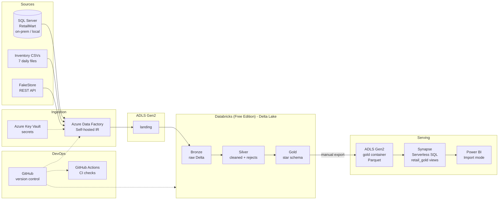
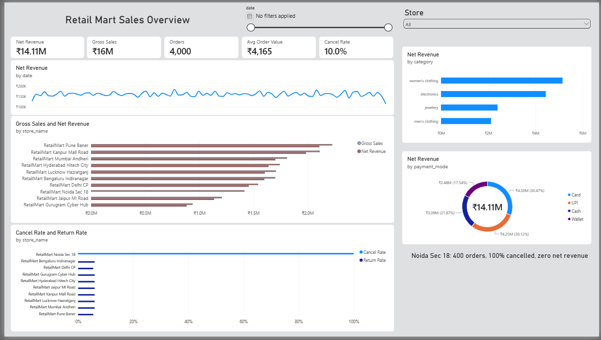
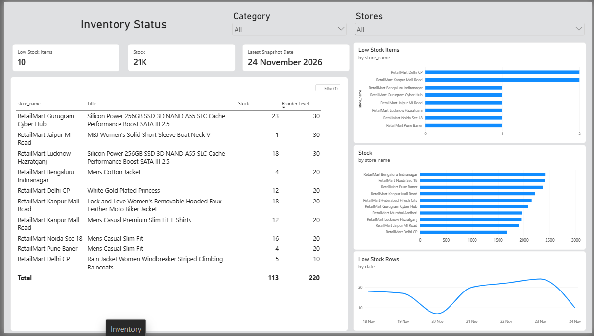
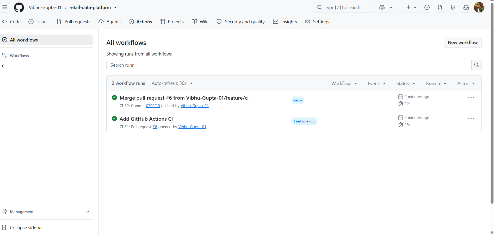

# Enterprise Retail Data Platform: Batch Pipeline on Azure


An end-to-end batch data pipeline for a fictional retail chain, **RetailMart**. It pulls data from three different source systems, lands it in a data lake, cleans and models it with a Medallion architecture (Bronze, Silver, Gold), serves it through Synapse, and reports on it in Power BI.

> The data is simulated. The stores, customers, orders and inventory were generated for this project, and some dirty data was seeded deliberately to test the data quality checks.

---

## 1. Business problem

RetailMart runs 10 stores. Its data sits in three places that do not talk to each other:

| Source | What it holds | Format |
|---|---|---|
| SQL Server (`RetailMart`) | Stores, customers, orders, order items | Relational tables |
| Inventory CSV exports | Daily stock snapshot per store and product | 7 daily CSV files |
| Product REST API (FakeStore) | Product catalogue | JSON |

Management cannot answer basic questions without manually stitching these together:

- How much did we really sell once cancelled and returned orders are removed (gross vs net sales)?
- Which stores have unusual cancellation rates?
- What is the stock position per store and product, and is the stock data trustworthy?

This project builds a repeatable pipeline that answers these questions from one clean, modelled source of truth.

---

## 2. Architecture



---

## 3. Tech stack and why each tool was chosen

| Tool | Role | Why this choice |
|---|---|---|
| **SQL Server Express** | Operational source | A realistic relational source, free, and runs locally |
| **Azure Data Factory** | Orchestration and ingestion | Native connectors for SQL Server, REST and ADLS; low-code and widely used in industry |
| **Self-hosted Integration Runtime** | Secure bridge to the local SQL Server | The database is not exposed to the internet. The REST source is also routed through it because the API blocked ADF's Azure auto-resolve runtime |
| **Azure Key Vault** | Secret storage | The SQL login password is never stored in ADF or in the repo |
| **ADLS Gen2** | Data lake (`landing`, `bronze`, `silver`, `gold`) | Cheap, scalable storage with a hierarchical namespace, the standard lake on Azure |
| **Managed identity** | ADF-to-ADLS access | No keys to manage or leak |
| **Databricks Free Edition** | Transformation (PySpark, Delta Lake) | Free for a portfolio project. Delta gives ACID tables and a clean Medallion layout |
| **Delta Lake** | Table format for Bronze, Silver, Gold | Reliable tables, schema enforcement, easy reconciliation |
| **Synapse Serverless SQL** | Serving layer | Pay per query with no dedicated pool to run and pay for. Views over Gold Parquet |
| **Power BI** | Reporting | Standard BI tool, with a star schema model and DAX measures |
| **GitHub + GitHub Actions** | Version control and CI | ADF is connected to Git (feature branch, pull request, publish), the way teams actually work. A CI workflow validates the ADF JSON, notebooks and scripts and scans for secrets on every pull request |

---

## 4. Data flow

### Landing
ADF copies raw data into ADLS `landing`:
- SQL Server tables (`stores`, `customers`, `orders`, `order_items`) land as **Parquet** in date folders, e.g. `sqlserver/<table>/YYYY/MM/DD/`. A parameterised **ForEach** pipeline loops over the table list.
- The 7 inventory CSVs land as they are.
- The product API response lands as **JSON Lines** (`products.json`, 20 products).
- A master pipeline, `pl_master_ingest`, runs all three ingestions.

### Bronze: raw, no business rules
Notebook `01_bronze_ingest` loads every source into Delta tables with no changes, so there is always a faithful copy of what arrived.

### Silver: cleaned and validated
- `02_silver_inventory` fixes the inventory data (see section 5). Bad rows go to a `inventory_rejects` table instead of being silently dropped.
- `03_silver_core` cleans stores, customers, orders, order items and products, with checks for duplicate keys, orphans, invalid quantities and prices, future dates and malformed emails.

### Gold: star schema for analytics

| Table | Rows |
|---|---|
| `dim_store` | 10 |
| `dim_customer` | 200 |
| `dim_product` | 20 |
| `dim_date` | 88 |
| `fact_sales` | 12,001 |
| `fact_inventory_snapshot` | 1,400 |

### Serving
Gold is exported as Parquet files, uploaded to the ADLS `gold` container, and exposed through views in a Synapse serverless database (`retail_gold`). Power BI connects to those views in Import mode.

---

## 5. Data quality findings

### Inventory: seeded dirty data
Each of the 7 daily inventory files had **204 rows** where **200** were expected. Every file contained the same four problems:

| Problem | Example | Handling |
|---|---|---|
| Exact duplicate row | Store 1 / Product 1 appears twice | Duplicate dropped |
| Conflicting duplicate (null stock) | Store 2 / Product 4: `null` vs `26` | Bad version rejected |
| Conflicting duplicate (negative stock) | Store 3 / Product 5: `-15` vs `179` | Bad version rejected |
| Orphan row | Store 99 does not exist | Rejected |

**Reconciliation:** Bronze 1,428 rows → Silver **1,400** valid rows, **21 rejects**, **7 duplicates dropped**. 1,428 − 7 − 21 = 1,400, so nothing is lost without a trace. Rejected rows are kept in `workspace.silver.inventory_rejects` with the reason.

### Other tables
Profiling of stores, customers, orders, order items and products found no nulls, duplicate keys, orphans, invalid quantities or prices, future dates, malformed emails, or orders without items. Only inventory had quality issues.

---

## 6. Business finding: Store 1 has no net sales

While building the Power BI model, one store stood out:

- **Store 1 (RetailMart Noida Sec 18)** has **400 orders, and all 400 are Cancelled**.
- Gross sales for the store are **1,416,645**, but net sales are **0**.
- These are **all** the Cancelled orders in the dataset (order status overall: Completed 3,388 / Cancelled 400 / Returned 212).

In a real company this would trigger an investigation: a payment or fulfilment failure, a system issue at that store, or bad data capture. The report therefore shows **gross vs net sales** and **cancellation rate by store**, so the problem is visible instead of hidden inside a total.

---

## 7. Dashboard

Power BI report on the Gold star schema, with measures for gross sales, net sales and cancellation rate by store.

| Page | Screenshot |
|---|---|
| Sales |  |
| Inventory |  |

The report file is in [`powerbi/`](powerbi/).

---

## 8. Repository structure

```
retail-data-platform/
├── .github/workflows/    # CI: validation checks and secret scan
├── adf/                  # ADF pipelines, datasets, linked services (Git-integrated)
├── sources/              # Scripts that build the sources: SQL Server, CSV generator, API notes
├── databricks/
│   └── notebooks/        # 00_verify_landing, 01_bronze_ingest, 02_silver_inventory,
│                         # 03_profile_bronze, 03_silver_core, 04_gold_model, 05_gold_export
├── docs/screenshots/     # Proof screenshots of the running pipeline
├── powerbi/              # .pbix file and dashboard screenshots
└── README.md
```

### CI

A GitHub Actions workflow (`.github/workflows/ci.yml`) runs on every pull request and every push to `main`:

- Validates all ADF JSON files and checks that every pipeline has activities
- Validates the Databricks notebooks
- Compiles the Python scripts
- Scans the full Git history for secrets with gitleaks



---

## 9. How to run it

**Prerequisites:** an Azure subscription, SQL Server Express, Power BI Desktop, a Databricks Free Edition account, and Java 11 on the self-hosted IR machine.

1. **Build the sources.** Create the `RetailMart` database with the SQL script in `sources/`, replacing the `<STRONG_PASSWORD_HERE>` placeholder with your own password for the read-only login (`adf_reader`). Generate the 7 inventory CSVs with the CSV generator script in `sources/`.
2. **Create Azure resources.** A resource group, an ADLS Gen2 account with containers `landing`, `bronze`, `silver`, `gold`, and a Key Vault holding the `adf_reader` password.
3. **Set up ADF.** Create the data factory, connect it to this GitHub repo (root folder `/adf`), and install the self-hosted integration runtime on the machine that can reach SQL Server. Set `JAVA_HOME` at system level for Parquet support.
4. **Ingest.** Import the ADF assets, then run `pl_master_ingest`.
5. **Transform.** In Databricks, create the `bronze`, `silver` and `gold` schemas and a landing volume, upload the landing files, then run the notebooks in order: `01_bronze_ingest` → `02_silver_inventory` → `03_silver_core` → `04_gold_model` → `05_gold_export`.
6. **Serve.** Upload the exported Gold Parquet files to the ADLS `gold` container, create a Synapse workspace, and create the `retail_gold` database with views over the Gold Parquet.
7. **Report.** Open the Power BI file, point it at the Synapse serverless endpoint, and refresh.

> No credentials are stored in this repo. Secrets live in Key Vault.

---

## 10. Limitations and next steps

- **Gold is moved manually.** Databricks Free Edition cannot write directly to ADLS, so Gold is exported to a Databricks volume, downloaded, and uploaded to the `gold` container with **Azure Storage Explorer**. With Azure Databricks and a Unity Catalog external location, this step would be automated inside the pipeline.
- **Databricks is not triggered by ADF.** Notebooks are run by hand for the same reason. In production, ADF would call Databricks as part of `pl_master_ingest`.
- **No automated deployment (CD).** CI runs on every pull request, but ADF is published manually from ADF Studio, which writes ARM templates to the `adf_publish` branch. A release pipeline that deploys them to a production factory was not built.
- **Full loads only.** Each run copies the full tables. Incremental loading with a watermark column would be the next improvement.
- **Simulated data.** Volumes are small and chosen for learning, not performance testing.
- **Power BI uses Import mode** with a manual refresh.

---

## 11. What this project demonstrates

- Ingesting from relational, file and API sources with ADF, including a self-hosted integration runtime
- Secure secret handling with Key Vault and managed identity
- Medallion architecture on Delta Lake with PySpark
- Data quality handling: validation, rejects tables and row-count reconciliation
- Dimensional modelling (star schema) and a serving layer on Synapse serverless
- Power BI modelling and reporting, with a real data insight surfaced
- Git-based workflow: feature branches, pull requests, publish, and automated CI checks with GitHub Actions
